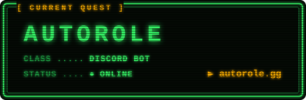

  

<h3 align="center">░▒▓ INVENTORY ▓▒░</h3>

  
  
  
  
   
  
  
  
  

<h3 align="center">░▒▓ CURRENT QUEST ▓▒░</h3>

  

<h3 align="center">░▒▓ HIGH SCORE ▓▒░</h3>

  <picture>
    <source media="(prefers-color-scheme: dark)" srcset="https://raw.githubusercontent.com/driverspy/driverspy/output/github-snake-dark.svg" />
    <source media="(prefers-color-scheme: light)" srcset="https://raw.githubusercontent.com/driverspy/driverspy/output/github-snake.svg" />
    
  </picture>

  

  

